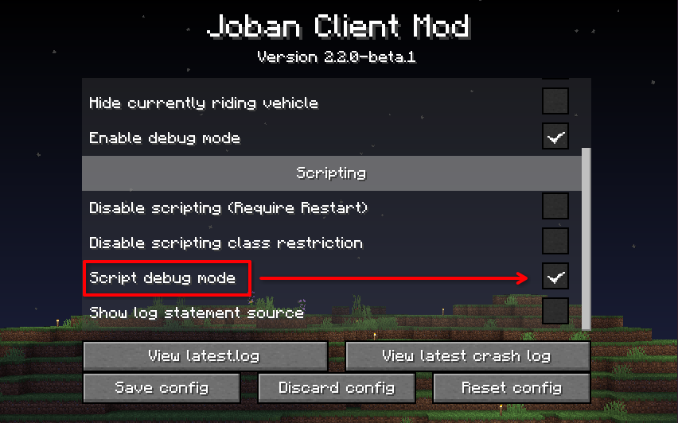
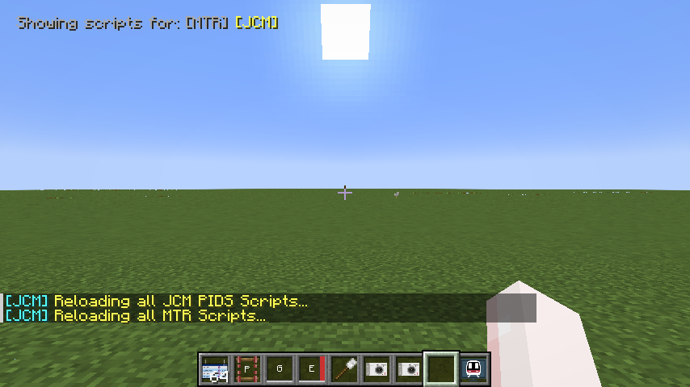

# Quick Reload

Since scripting is a part of a resource pack, to reload a script you usually have to reload the resource in-game by pressing F3+T.

To aid development time, JCM offers a **quick reload** feature which allows reloading of scripts without going through the normal resource pack reloading routine.

### Enable quick reload
Go to **Mod Menu** / **Mod Config Screen** (Forge), find JCM and click on **Configure**.  
After that, make sure the **Script debug mode** checkbox is checked, then click **Save Config**.

### Using quick reload
After enabling debug mode, you can press the following key combination:

- ++ctrl+r++ to reload MTR scripts. (i.e. Eyecandy Scripts)
- ++shift+r++ to reload JCM scripts. (i.e. Scripted PIDS Preset)

!!! note "Note on keybinding"
    The above assumes a default unmodified key binding, see below for the corresponding keybinds:
    
    - ++ctrl++ refers to your binded Sprint key
    - ++shift++ refers to your binded Sneak key
    - ++r++ refers to your binded JCM reload key, configurable in key binding settings.

Please note that for the reloading process, script registries/entries (e.g. Those in `mtr_custom_resources.json`) are also re-parsed, rather than only reloading all loaded scripts.